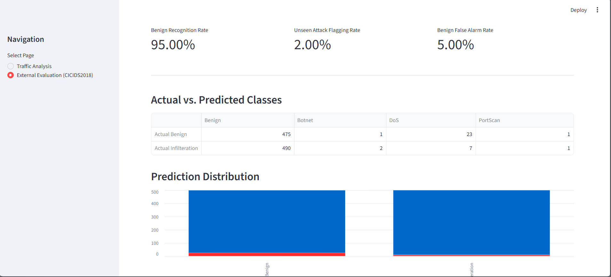
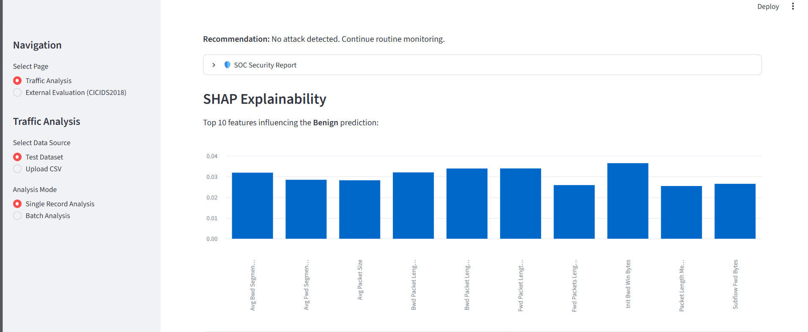

# 🛡️ CyberThreat-LLM
### AI-Powered Network Threat Detection and Analysis

CyberThreat-LLM is a machine learning-based cybersecurity project designed to detect and analyze suspicious network traffic.

The system uses **Random Forest classification**, **SHAP explainability**, and **risk assessment** to support network threat analysis through an interactive **Streamlit dashboard**.

> **Project Status:** Machine learning-based detection is implemented. LLM-powered threat explanations are planned for future development.

---

## 1. Technologies & Datasets

| Technology | Purpose |
|---|---|
| Python, Pandas, NumPy | Data processing and analysis |
| Scikit-learn, Random Forest | Threat classification |
| SHAP | Prediction explainability |
| Streamlit | Interactive dashboard |
| Matplotlib | Data visualization |
| Joblib | Model management |

**Datasets**

- **CICIDS2017:** Model training, testing, and classification.
- **CICIDS2018:** Preliminary external evaluation.
- **External CSV:** Additional network traffic analysis with compatible features.

---

## 2. System Architecture

The system follows a machine learning-based threat detection workflow.

```text
Network Traffic Dataset
          |
          v
   Data Preprocessing
          |
          v
   Feature Preparation
          |
          v
   Random Forest Model
          |
          v
  Threat Classification
          |
     +----+----+
     |         |
     v         v
    SHAP    Risk Analysis
     |         |
     +----+----+
          |
          v
   Streamlit Dashboard
```

---

## 3. Results & Evaluation

Model performance is examined through classification metrics, prediction distributions, and explainability analysis.

### Classification Performance

Evaluation metrics include **Accuracy, Precision, Recall, F1-score**, and **Confusion Matrix**.



### External Dataset Evaluation — CICIDS2018

A preliminary evaluation was conducted using 1,000 traffic records: 500 Benign and 500 Infilteration samples.

| Evaluation Metric | Result |
|---|---:|
| Benign Recognition Rate | 95.00% |
| Unseen Attack Flagging Rate | 2.00% |
| Benign False Alarm Rate | 5.00% |

**Evaluation:** The model correctly recognized most benign samples but showed limited ability to flag the unseen Infilteration attack class. These preliminary results highlight challenges in generalizing across datasets.


### SHAP Explainability

SHAP is used to identify the network flow features that influence individual model predictions.



---

## 4. Streamlit Dashboard

The interactive dashboard provides:

- Single-record and batch traffic classification
- Class probability visualizations
- Security risk assessment and SOC-style reports
- SHAP-based prediction explanations
- External CSV upload and analysis
- Downloadable batch analysis results


**Development Note:** ChatGPT was used as a development assistant for Streamlit interface implementation, layout organization, and troubleshooting. The project's primary technical focus is data preprocessing, machine learning, and cybersecurity analysis.

---

## 5. Installation & Usage

**Clone the repository**

```bash
git clone https://github.com/sudeilhn/CyberThreat-LLM.git
cd CyberThreat-LLM
```

**Create and activate a virtual environment (Windows)**

```bash
python -m venv .venv
.venv\Scripts\activate
```

**Install dependencies**

```bash
pip install -r requirements.txt
```

**Launch the dashboard**

```bash
streamlit run app.py
```

The application opens at `http://localhost:8501`.

**Note:** Trained model files and large datasets may need to be generated or prepared locally before running the application. External CSV inputs must contain compatible features and valid numerical values.

---

## 6. Limitations & Future Work

**Current Limitations**

- Detection performance may decrease on unseen datasets and attack types.
- External CSV files require compatible feature structures.
- Model predictions are not confirmed security incidents.
- The current system does not include an integrated LLM pipeline.

**Future Improvements**

- LLM-based natural-language threat explanations
- Improved cross-dataset generalization
- Additional model comparisons and evaluation
- Enhanced CSV compatibility and real-time analysis

---

**Disclaimer:** This project is intended for educational, research, and defensive cybersecurity purposes. It is not a production-ready intrusion detection system.
